<a href="https://www.usereuben.com">
  <picture>
    <source media="(prefers-color-scheme: dark)" srcset="assets/header-dark.svg">
    <source media="(prefers-color-scheme: light)" srcset="assets/header-light.svg">
    
  </picture>
</a>

  <a href="https://www.usereuben.com"><picture><source media="(prefers-color-scheme: dark)" srcset="assets/link-web-dark.svg"><source media="(prefers-color-scheme: light)" srcset="assets/link-web-light.svg"></picture></a>
  <a href="https://www.linkedin.com/in/reuben-tomoloju/"><picture><source media="(prefers-color-scheme: dark)" srcset="assets/link-linkedin-dark.svg"><source media="(prefers-color-scheme: light)" srcset="assets/link-linkedin-light.svg"></picture></a>
  <a href="https://twitter.com/tomoloj_"><picture><source media="(prefers-color-scheme: dark)" srcset="assets/link-x-dark.svg"><source media="(prefers-color-scheme: light)" srcset="assets/link-x-light.svg"></picture></a>
  <a href="mailto:reztomoloju@gmail.com"><picture><source media="(prefers-color-scheme: dark)" srcset="assets/link-email-dark.svg"><source media="(prefers-color-scheme: light)" srcset="assets/link-email-light.svg"></picture></a>
  <a href="https://profiles.wordpress.org/reztomoloju/"><picture><source media="(prefers-color-scheme: dark)" srcset="assets/link-wordpress-dark.svg"><source media="(prefers-color-scheme: light)" srcset="assets/link-wordpress-light.svg"></picture></a>

 

<picture>
  <source media="(prefers-color-scheme: dark)" srcset="assets/heading-capabilities-dark.svg">
  <source media="(prefers-color-scheme: light)" srcset="assets/heading-capabilities-light.svg">
  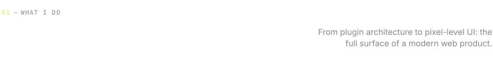
</picture>

<picture>
  <source media="(prefers-color-scheme: dark)" srcset="assets/capabilities-dark.svg">
  <source media="(prefers-color-scheme: light)" srcset="assets/capabilities-light.svg">
  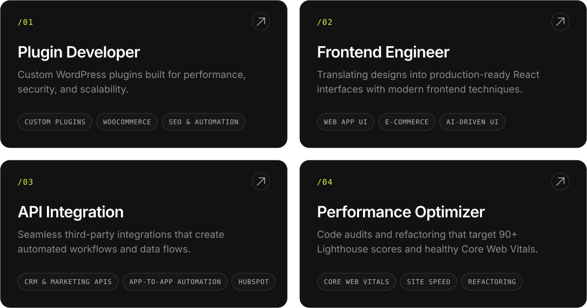
</picture>

  

<picture>
  <source media="(prefers-color-scheme: dark)" srcset="assets/heading-experience-dark.svg">
  <source media="(prefers-color-scheme: light)" srcset="assets/heading-experience-light.svg">
  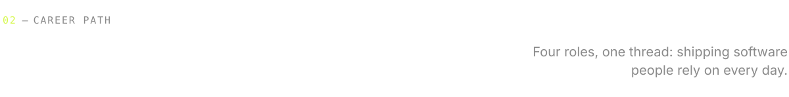
</picture>

<picture>
  <source media="(prefers-color-scheme: dark)" srcset="assets/experience-dark.svg">
  <source media="(prefers-color-scheme: light)" srcset="assets/experience-light.svg">
  
</picture>

  

<picture>
  <source media="(prefers-color-scheme: dark)" srcset="assets/heading-work-dark.svg">
  <source media="(prefers-color-scheme: light)" srcset="assets/heading-work-light.svg">
  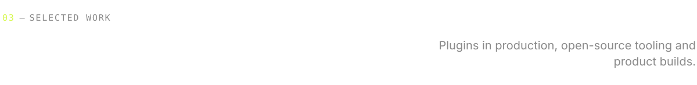
</picture>

  <a href="https://linksyai.com"><picture><source media="(prefers-color-scheme: dark)" srcset="assets/project-linksy-dark.svg"><source media="(prefers-color-scheme: light)" srcset="assets/project-linksy-light.svg"></picture></a>
  <a href="https://github.com/Rubylenshy/wp-alchemist-framework"><picture><source media="(prefers-color-scheme: dark)" srcset="assets/project-wp-alchemist-dark.svg"><source media="(prefers-color-scheme: light)" srcset="assets/project-wp-alchemist-light.svg"></picture></a>
  <a href="https://plugli.com"><picture><source media="(prefers-color-scheme: dark)" srcset="assets/project-alttexty-dark.svg"><source media="(prefers-color-scheme: light)" srcset="assets/project-alttexty-light.svg"></picture></a>
  <a href="https://plugli.com"><picture><source media="(prefers-color-scheme: dark)" srcset="assets/project-datey-ai-dark.svg"><source media="(prefers-color-scheme: light)" srcset="assets/project-datey-ai-light.svg"></picture></a>
  <a href="https://github.com/Rubylenshy/spiritwise"><picture><source media="(prefers-color-scheme: dark)" srcset="assets/project-spiritwise-dark.svg"><source media="(prefers-color-scheme: light)" srcset="assets/project-spiritwise-light.svg"></picture></a>
  <a href="https://agile-system.vercel.app"><picture><source media="(prefers-color-scheme: dark)" srcset="assets/project-agile-system-dark.svg"><source media="(prefers-color-scheme: light)" srcset="assets/project-agile-system-light.svg"></picture></a>

 

<picture>
  <source media="(prefers-color-scheme: dark)" srcset="assets/heading-stack-dark.svg">
  <source media="(prefers-color-scheme: light)" srcset="assets/heading-stack-light.svg">
  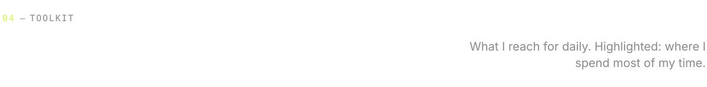
</picture>

<picture>
  <source media="(prefers-color-scheme: dark)" srcset="assets/stack-dark.svg">
  <source media="(prefers-color-scheme: light)" srcset="assets/stack-light.svg">
  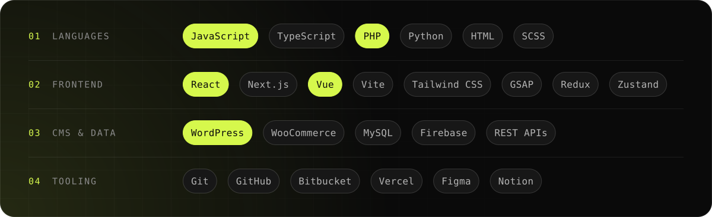
</picture>

  

<a href="https://www.usereuben.com/start-a-project">
  <picture>
    <source media="(prefers-color-scheme: dark)" srcset="assets/footer-dark.svg">
    <source media="(prefers-color-scheme: light)" srcset="assets/footer-light.svg">
    
  </picture>
</a>

<!-- Artwork is generated from scripts/build_assets.py; edit the data there and re-run it. -->
